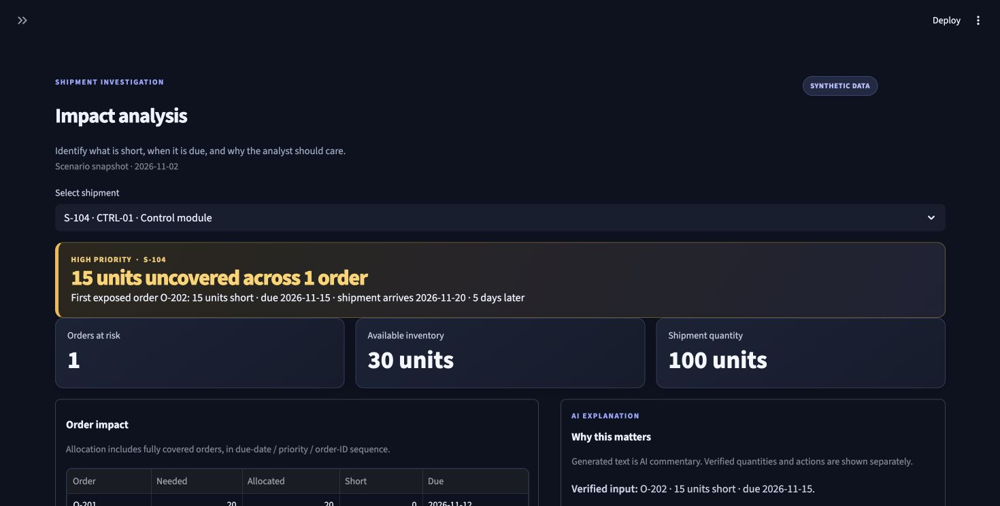

# SupplyChain Copilot (prototype)

A working decision-support prototype for an operations analyst investigating delayed
inbound supply. It uses Firebase Cloud Firestore seeded from a reproducible, clearly
labeled synthetic dataset: 50 shipments, 50 SKUs, 50 inventory balances, 248 customer
order lines, and 12 demo accounts. No private or real-company data is used.

[Live demo](https://supplychain-copilot-252e.onrender.com/) · [Three-minute walkthrough](docs/demo_script.md)

[Local verification and remaining release work](docs/release_status.md)



Decision support with optional AI commentary: Python owns allocation, shortages, and
policy actions so the results stay inspectable when generation is unavailable.

## Try it without Firebase

```bash
python3.12 -m venv .venv
source .venv/bin/activate
python -m pip install -r requirements.txt
python scripts/run_offline_demo.py
```

Open http://127.0.0.1:8501. This uses the same UI and a seeded, in-memory Firestore
fake; it needs no cloud credentials and loses changes on restart. AI is disabled
by default. All operational data is synthetic.

```bash
python -m unittest discover -s tests -v
python -m src.evaluate --offline
```

CI runs these commands without credentials or paid calls. The original 34 tests
plus focused regressions run locally; dependency versions are pinned in
`requirements.txt`. Python 3.12.14 was tested fresh; Python 3.12 is the CI/deployment target (also tested on the
existing local Python 3.9.6 environment).

## Run with Firestore

Requires Python 3.12 for the documented fresh environment. Before running the app, create a Firebase project, enable Cloud Firestore in Native mode, and configure a server-side service-account JSON path as described in [`docs/database_guide.md`](docs/database_guide.md). Keep that credential outside this repository. Install dependencies with:

```bash
python3 -m venv .venv
source .venv/bin/activate
python -m pip install -r requirements.txt
python scripts/generate_synthetic_data.py  # optional: regenerate labeled CSV seed records
export FIREBASE_PROJECT_ID="your-firebase-project-id"
export GOOGLE_APPLICATION_CREDENTIALS="$HOME/.config/supplychain-copilot/firebase-service-account.json"
python scripts/build_database.py          # seed Firestore from the CSV records
python -m unittest discover -s tests -v  # uses an in-memory fake; no Firebase credentials needed
python -m src.evaluate
python -m src.evaluate_agent  # live OpenAI answer checks; uses API credits
python -m src.cli             # terminal interface
streamlit run src/web_app.py  # visual interface
```

For private live generation only, set `ENABLE_LIVE_AI=true` and `OPENAI_API_KEY` in the server environment or copy `.streamlit/secrets.toml.example` to `.streamlit/secrets.toml` and add your own key. Never paste the key into source code, chat, or commit the real secrets file. The model only receives the selected shipment's deterministic result and relevant policy excerpt; it has no database tools and does not calculate or choose actions. Without a key, the overview and deterministic analysis still work, while the AI panel shows the verified context and explains how to enable model-generated commentary. Set `OPENAI_MODEL` to override `gpt-4o-mini`.

## Deploy on Render

This project is a Streamlit server, so Render is the direct deployment target. `render.yaml` contains its build, start, health-check, and Firebase settings. In Render, create a Blueprint from this GitHub repository, then add a **Secret File** containing the Firebase service-account JSON at `/etc/secrets/firebase-service-account.json`. Keep `FIREBASE_PROJECT_ID` set to `evidence-ai-e962b`; leave `OPENAI_API_KEY` unset and `ENABLE_LIVE_AI=false` on the public service. The UI refuses generation unless live AI is explicitly enabled. Do not enable it publicly without a shared server-side request budget. Deploy and verify both pages and the `/_stcore/health` health check. The free Render service may sleep when idle.

Vercel does not directly host this Streamlit server. To use Vercel, the UI would need a separate Next.js frontend on Vercel and a Python API on Render; that is a larger frontend/backend rewrite, not a second deployment of the current app.

Example question: `Shipment S-104 is delayed. Which orders are at risk?`

## Architecture

- `src/database.py`: reads and seeds Firebase Firestore collections from versioned CSV records; order views resolve account and SKU references in Python.
- `src/supplychain.py`: validates database records and deterministically allocates stock.
- `src/documents.py`: extracts passages from saved CBP HTML pages and the
  synthetic playbook, then ranks them with BM25 plus a small explicit synonym map.
- `src/assistant.py`: bounded, read-only tool workflow; currently routes using
  a shipment-ID pattern, not an LLM planner.
- `src/cli.py`: simple interactive demo.
- `src/web_app.py` + `src/pages/`: dark-themed, two-page Streamlit workspace. Overview has portfolio-level risk metrics, an exposure chart, and shipment register; Shipment analysis drills into order-level evidence and analyst next steps.
- `tests/` and `evals/cases.json`: calculation, validation, retrieval, workflow,
  and deterministic golden-case evaluations. Run `python -m src.evaluate` to
  see tool/retrieval results. Run `python -m src.evaluate_agent` for live answer
  checks; it calls the model, uses API credits, and saves outputs under `evals/`.

The AI decision brief is an explanation layer: deterministic Python computes the result, then the model receives only that result and a relevant policy passage to summarize it. The model cannot call tools, query the database, change figures, or execute actions. Unknown shipments and missing delay causes are handled deterministically. The separate document retrieval uses BM25 and a small synonym map; it is lexical search, not embedding-based semantic retrieval. The AI brief requires an API key and network access.

See [`docs/architecture.md`](docs/architecture.md) for the system diagram,
[`docs/database_guide.md`](docs/database_guide.md) to connect and seed Firebase,
and [`docs/demo_script.md`](docs/demo_script.md) for a short walkthrough.
Source-selection decisions and failed fetch checks are recorded in
[`docs/sources/README.md`](docs/sources/README.md).

## Assumptions and limitations

- All shipment, inventory, customer, product, and order records are synthetic scenario data; they do not describe an actual company.
- The 50-shipment database is large enough to exercise multiple scenarios in this portfolio prototype, but it is not historical or enterprise-operational data.
- Orders due on the shipment arrival date are treated conservatively as at risk.
- Allocate current inventory by earliest due date, then lower numeric priority,
  then order ID. Lower priority number means higher priority.
- Each demo SKU has one inbound shipment. The prototype analyzes one selected shipment at a time and does not aggregate multiple incoming shipments, reserved stock, partial shipment arrivals, or supplier substitutions.
- CBP reference pages are general import guidance, not proof of a shipment's
  delay, status, or business impact. The BrightHome playbook is synthetic demo
  policy, not a real company procedure. Keep those source types distinct.
- The language model is not trained or fine-tuned on the database. It receives the selected precomputed result only to explain it; deterministic Python code does the arithmetic and chooses permitted next steps. The separate document retrieval uses lexical BM25 with a small synonym map and can still miss paraphrases.

## Verified output and AI limits

The allocation rule is earliest due date, lower numeric priority, then order ID;
orders due on arrival day are included conservatively. S-104 allocates 20 of 30
units to O-201, leaving 10 for O-202 and a 15-unit shortfall. S-105 has no exposed
orders. S-106 has 53 uncovered units across three orders; O-209 itself is short 13.
An individual shortfall above 10 triggers same-day review; two six-unit shortages
do not. The allocation table includes covered orders so the result is inspectable.

Structured generated order IDs, shortages, action IDs, delay cause, and delivery
promise are validated against deterministic ground truth before acceptance.
AI text is labeled commentary, while verified values/actions render separately.
Conservative prose checks reject several known contradictions and unsupported
claims, but cannot prove arbitrary natural-language factual correctness. A failure
case is a fabricated customs delay: no cause is recorded, so it is rejected rather
than treated as shipment evidence. BM25 retrieval remains lexical and can miss
paraphrases. No model grades another model.

Public cost policy: keep live generation disabled and the public OpenAI key unset.
The repository configuration disables UI generation even if a key exists. Verify
actual Render settings before release; repository changes do not update a running
service. For a real AI recording, privately enable generation and run single-order,
multiple-order, and no-shortage paid checks. No real AI recording is bundled yet;
do not present mocked/offline output as a real generated response.
