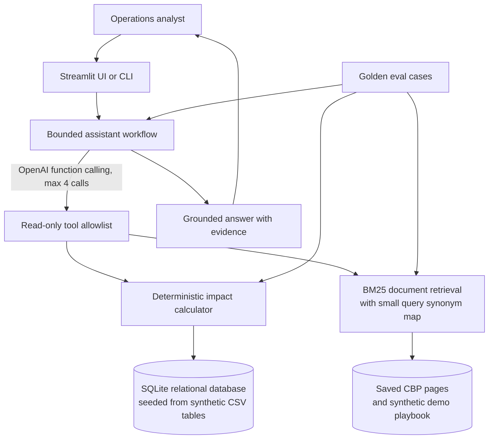

# SupplyChain Copilot architecture

## Request flow

1. The analyst selects a shipment or asks a question.
2. Deterministic guards answer known missing facts (unknown shipment IDs, absent delay cause, or unsupported actions) without asking the model to guess.
3. For other questions, the OpenAI model can call only the read-only shipment-impact, shipment-lookup, and document-search tools. The tool budget is capped.
4. Python calculates order shortfalls from SQLite records. BM25 retrieves document passages and source identifiers; the model explains the returned evidence.
5. Golden evaluations check calculation results, retrieval sources, and selected answer requirements.

## Data boundaries

- SQLite is the runtime store, reproducibly seeded from versioned synthetic CSVs for shipments, inventory, orders, items, and demo accounts.
- The local synthetic playbook is the authority for demo escalation policy, not real-company policy.
- The language model is not trained or fine-tuned on the records; it reads selected facts at request time through tools. Python performs calculations.
- CBP pages provide general import guidance only. They do not establish a shipment's delay cause or business impact.
- BM25 is a lexical ranker with a small explicit synonym map; it is not embedding-based semantic search.
