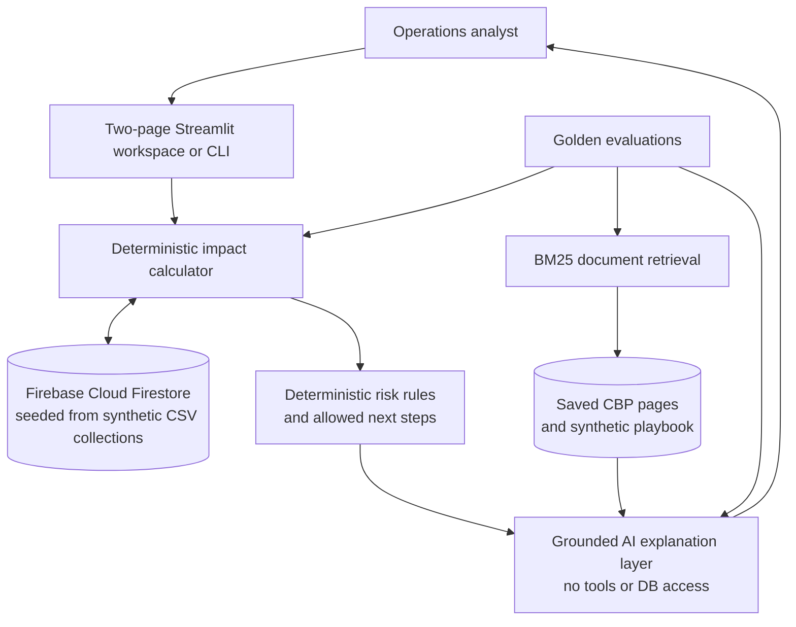

# SupplyChain Copilot architecture

## Request flow

1. The Overview page summarizes shipment exposure. The analyst selects a shipment on Shipment analysis.
2. Python reads related documents from Firebase Firestore and calculates inventory allocation and uncovered quantities. Explicit rules derive the allowed analyst next step.
3. BM25 retrieves the relevant policy excerpt. The model receives only the precomputed result and policy passage, then returns a concise explanation; it has no tools, database access, or authority to change values/actions.
4. Unknown shipments, missing delay causes, and unsupported actions are handled deterministically. If AI is unavailable, the verified result and recommendation still display.
5. Evaluations check deterministic calculations, retrieval sources, explanation structure, and selected answer requirements.

## Data boundaries

- Firebase Cloud Firestore is the runtime store, seeded from versioned synthetic CSVs for shipments, inventory, orders, items, and demo accounts. Stable document IDs mirror each record's business key.
- The local synthetic playbook is the authority for demo escalation policy, not real-company policy.
- The language model is not trained or fine-tuned on these records and cannot query them. It explains a bounded context supplied by application code; Python performs calculations and applies policy.
- CBP pages provide general import guidance only. They do not establish a shipment's delay cause or business impact.
- BM25 is a lexical ranker with a small explicit synonym map; it is not embedding-based semantic search.
